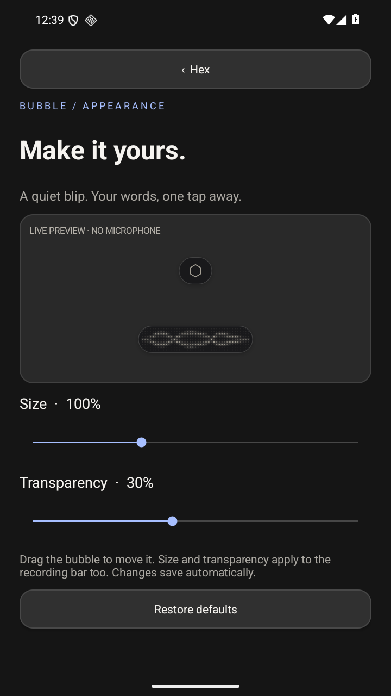

# Hex Mobile

An independent Android companion inspired by [Hex](https://anoma.ly/hex).
Keep your keyboard, tap a text field, and use the movable Hex bubble to dictate.

## What works in this first build

- Native Android accessibility overlay. Starts on the right, drags anywhere,
  remembers its position, and hides outside editable fields and in passwords.
- Semi-transparent by default. **Bubble appearance** adjusts size (75–150%) and
  transparency (0–70%) with a live preview; both apply to the recording bar too.
  Even the smallest setting keeps a 48 dp touch target.
- Hex-inspired dot-scope recording bar: voice-reactive paired dot waves, pearl
  while recording, blue while processing, and a compact hairline hexagon at rest.
- Tap to start/stop; hold to cancel. Recording notification includes Cancel.
  Maximum recording: two minutes. Locking the screen cancels recording.
- Replaces the current selection without dropping surrounding text. If focus,
  text or selection changes, retains the transcript in memory for explicit recovery.
- Optional Android **on-device** recognizer; no silent cloud fallback.
- Private server mode over **Tailscale HTTPS**, with an additional bearer token.
- Six checksum-verified server model downloads, including **Parakeet Unified
  English** and **Cohere Transcribe**, using the same transcribe.cpp model family
  and GGUF weights as desktop Hex. One model and its inference session stay resident
  at a time. The server preloads the last prepared model at startup.
- Focus-triggered preflight opens the server connection and warms the selected model
  before audio arrives. After idle, a synthetic silent warmup wakes the GPU.
- A tiny non-focusable recording shim preserves editor/keyboard focus; cancelled or
  interrupted startup requests cannot start a later microphone session.

This is a first functional port of the interaction and visual language, not the
full desktop application. The server transcribes after recording stops. Live
streaming, rewriting, custom vocabulary, persistent history, and phone-local GGUF
inference are not implemented. English is selected for server inference in this
build. Model weights remain on the chosen server, not the phone.



## Build

JDK 17 or newer, Android SDK 36, and an Android SDK path via `ANDROID_HOME` or
`local.properties`. The Gradle wrapper pins Gradle 9.1.0; AGP is 9.0.1.

```sh
./gradlew :app:assembleDebug :app:lintDebug
```

APK: `app/build/outputs/apk/debug/app-debug.apk`.
Minimum Android version: 12 / API 31. No JavaScript build toolchain is needed.

## Server (Windows / Godseye)

From `server/`:

```powershell
uv sync --python 3.12 --frozen
.\.venv\Scripts\python.exe hex_server.py --backend vulkan
```

The installed transcribe.cpp native wheel includes Vulkan support. The server
creates `.server-token` on first launch. Keep that private. Enter its value in the
app's server token field. Audio stays in memory; transcripts are not logged by the
HTTP layer. Native engine diagnostics may report model names and buffer sizes.

The server listens **only on loopback**. Inspect existing Serve routes before
choosing an unused HTTPS port:

```powershell
tailscale serve status
tailscale serve --bg --https=8444 http://127.0.0.1:8765
```

Configure the phone with `https://<host>.<tailnet>.ts.net:8444`, and leave Tailscale
connected on both devices. This is private Serve, not public Funnel. The configured
host for this workspace is documented in `docs/validation.md`.

Open **Transcription models** in the app to download and select a model. All files
are pinned to upstream revisions and checked against SHA-256 before use. Disk
usage is shown before download. Models are loaded on demand; the first transcription
can still take longer if a request arrives before preparation finishes, or if the
host is waking up. Parakeet and Cohere
were installed on Godseye during development. Other catalog entries require testing.

`scripts/install-server-task.ps1` registers a task to run inference at user logon.
To remove it: stop and unregister `Hex Mobile Inference` in Task Scheduler, then
run `tailscale serve --https=8444 off` to remove only this service's route.

## Android setup

1. Install the APK. Open Hex and grant microphone access.
2. Read the accessibility disclosure and enable Hex Mobile in Android settings.
   Sideloaded apps may require **App info → ⋮ → Allow restricted settings** first.
3. Choose offline phone recognition, or save the server URL and token and pick a model.
4. Open **Bubble appearance** to customize the blip and recording bar.
5. Open a normal text field in another app and tap the bubble. Tap again to finish.

Accessibility sees the focused field and cursor so it can insert text. Field
contents are never sent to the server. Password fields are excluded. Some custom
editors and WebViews do not expose the needed accessibility actions. The current
`ACTION_SET_TEXT` fallback may not preserve rich-text formatting. There is no
claim of compatibility with every app.

## Tests

```sh
python3 -m unittest discover -s server/tests -v
```

`scripts/test-emulator.ps1` builds, installs, and runs the Android instrumentation
suite on an emulator only. Configure its server URL/token first. Tests use a separate
`Hex Test Fields` fixture app and the public JFK sample from whisper.cpp. Real-model
tests require Parakeet Unified English and Cohere installed on the server. Tests
exercise focus, selections, empty fields, password exclusion, cancellation,
microphone foreground-service startup, saved appearance controls and overlay
resizing, and real model transcription/insertion.

The S21 is configured with Hex accessibility and microphone access, Parakeet on
Godseye, and the private Tailscale endpoint. Wispr Flow is stopped. Both installed
models passed prerecorded-speech transcription over the phone’s HTTPS connection.

See [validation](docs/validation.md) for actual results and remaining device checks.
See [third-party notices](THIRD_PARTY_NOTICES.md) for attribution and port differences.

See [latency and keyboard handoff validation](docs/latency-and-handoff.md) for the
0.1.3 changes and measurements.
